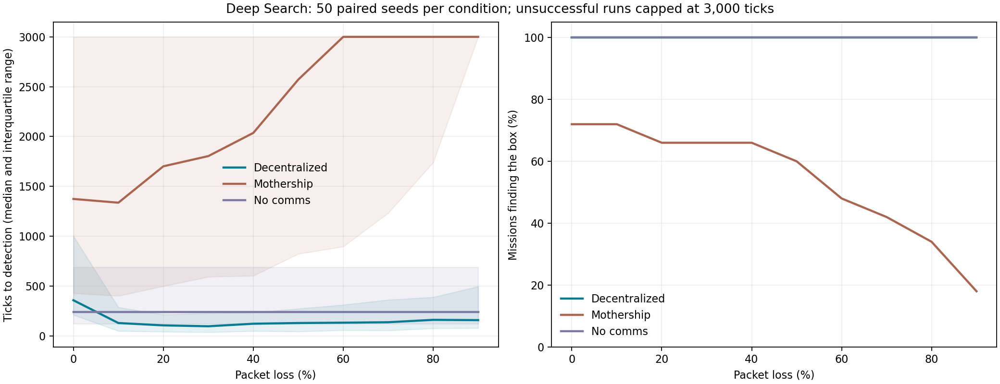

# Measured results

1,700 missions; 50 paired seeds per condition. Generated 2026-11-14T15:19:03.585Z. Full data: `../public/results.json`.

| Scenario | Strategy | Packet loss | Median ticks | 25–75% | Found | Redundant scans |
|---|---|---:|---:|---:|---:|---:|
| Normal | Decentralized | 0% | 357 | 210.5–1001.25 | 100% | 83.6% |
| Normal | Decentralized | 70% | 136.5 | 54–361.75 | 100% | 52.1% |
| Normal | Mothership | 0% | 1373.5 | 427.25–3000 | 72% | 4.7% |
| Normal | Mothership | 70% | 3000 | 1232.25–3000 | 42% | 4.2% |
| Normal | No comms | 0% | 240.5 | 120.75–688.75 | 100% | 78.1% |
| Normal | No comms | 70% | 240.5 | 120.75–688.75 | 100% | 78.1% |
| Hub killed at 200 | Decentralized | 0% | 357 | 210.5–1001.25 | 100% | 83.6% |
| Hub killed at 200 | Decentralized | 70% | 136.5 | 54–361.75 | 100% | 52.1% |
| Hub killed at 200 | Mothership | 0% | 3000 | 3000–3000 | 16% | 4.6% |
| Hub killed at 200 | Mothership | 70% | 3000 | 3000–3000 | 12% | 3.7% |

The expected ranking in the brief is not universal. Decentralized gossip beats no-comms at 70% loss in this sample, but loses at zero loss. The centralized strategy is not the fastest at zero loss either. High message reliability does not guarantee efficient movement: the specified policy can repeatedly coordinate around nearby targets. This explanation is a hypothesis about the policy, not a separately controlled experiment.

Hub failure strongly exposes dependence on central assignments. Decentralized results are unchanged by killing an unused mothership. Some centralized missions finish before tick 200; the success rate includes those runs. The full 0–90% sweep, including unfavorable conditions, is retained.

These are deterministic simulation results under one prior and one parameter setting. Fifty seeds describe variability in this setup, not validation on real ocean missions. The shaded chart bands are interquartile ranges, not confidence intervals. Failures are censored at maxTicks; a median of 3,000 indicates censoring rather than a measured detection.

No parameter tuning was performed to force a winning ranking. A correction to the redundancy metric and the centralized replanning interval was applied before the final sweep.

