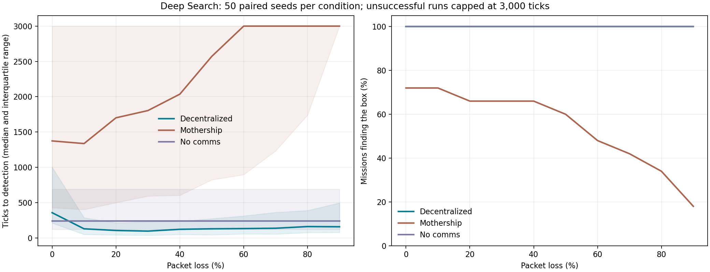

# Deep Search — six-slide content deck

## 1. Ocean search

Six underwater drones search for an aircraft's black box.
Communication can fail. The search must continue.

Speaker note: This is a simulation, not a deployed fleet. Avoid the brief's time-sensitive MH370 claims unless checked against current official sources immediately before judging.

---

## 2. Independent actors, shared evidence

Each drone maintains its own Bayesian probability map.
It chooses a target using expected detection gain, travel distance and peer intentions.
Signed scan records merge by set union: a G-Set CRDT.

Speaker note: Failed scans reduce probability by a factor of 1 − pDetect. Stale peer intentions fade exponentially. No central controller chooses targets in decentralized mode.

---

## 3. Live failure demonstration

Set packet loss to 70%.
Trigger an acoustic blackout.
Kill the centralized mothership, then switch to independent decisions.

Speaker note: Maps converge through bounded record exchange after reconnection. They do not become globally identical instantly. A killed drone's unshared knowledge stays unavailable to other actors.

---

## 4. Measured search performance

At 70% loss: decentralized median 136.5 ticks; no-comms 240.5 ticks.
At zero loss: decentralized 357 ticks; no-comms 240.5 ticks.
50 paired seeds per condition; failures capped at 3,000 ticks.

Speaker note: Source: ../public/results.json. Discuss both latency and redundancy. Do not claim that decentralized gossip beats no-comms unless these measurements support it. Hub-failure scenarios are included separately.

---

## 5. Signed offline, committed on Solana

Every live scan has a registered drone's Ed25519 signature.
A surfaced batch becomes a Merkle root in a devnet Memo.
The fallback bounty is a 0.001 SOL wallet transfer.

Speaker note: Show a real confirmed Explorer transaction if available. Anchor escrow source is prepared but not deployed. The Memo authenticates a commitment, not a physical search. Detection remains a trusted sensor report.

---

## 6. Next: test the physical assumptions

Bound acoustic bandwidth and energy consumption.
Model 3D terrain and real vehicle dynamics.
Require recovery confirmation before paying a real bounty.

Speaker note: Neptune North is the primary target: common goal, independent decisions and resilience under failed communication. Solana provides offline identity and public commitments; production custody and recovery attestation remain future work.
